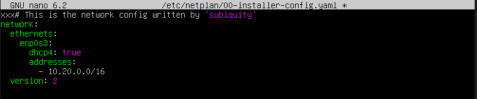

para esta práctica usamos tres maquinas
Primero tenemos ue ponerle ip a las maquina(hay dos que etan en red interna y les ponemos la ip que queremos configurando el siguiente archivo usando el comando sudo nano)ç

usamos el comando sudo netplan apply para aplicar los cambios de ip en las tarjetas de red.
Con el comado adduser creamos un nuevo usuario y para cambiarnos a él usamos el comando su+nombre

usamos este comando para generar las clave con las que luego haremos ssh scp ./id_rsa.pub remote@10.0.0.1:id_rsa.remote.pub