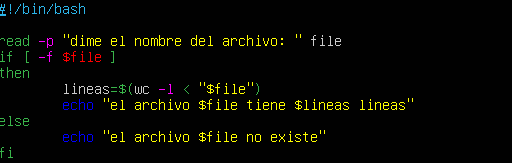
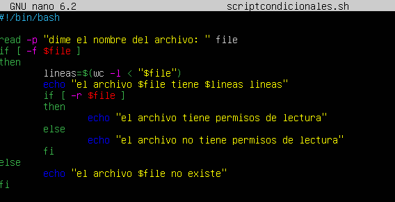
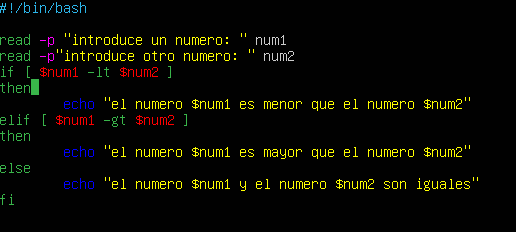
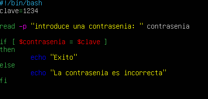
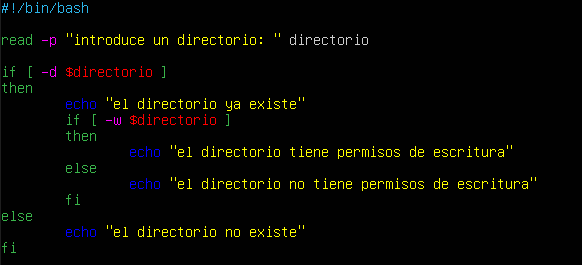
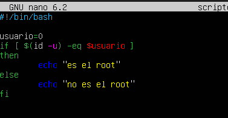
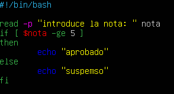

# PRACTICA 2 DE LA UT3 JULIÁN ALMARZA ÁLVAREZ

1. Escribe un script que solicite el nombre de un archivo y luego imprima cuántas líneas tiene ese archivo. Verifica que el archivo exista antes de contar las líneas.





2. Crea un script que compruebe si un archivo (cuya ruta pedirá al usuario por teclado) existe y si tiene permisos de lectura. Muestra un mensaje adecuado para cada caso





3. Realiza un script que solicite dos números al usuario y los compare, mostrando cuál es mayor, o si son iguales.

Para solicitar al usuario que tiene que introducir un valor por teclado tienes que utilizar el comando read tal como se muestra en el siguiente ejemplo:

```
read -p "Introduce tu usuario: " usuario
echo Bienvenido, $usuario
```





4. Escribe un script que solicite al usuario una contraseña y verifique si coincide con una contraseña predefinida (que estará almacenada en una variable de tu script). Si es correcta, muestra un mensaje de éxito, de lo contrario, indica que es incorrecta.





5. Crea un script que compruebe si un directorio (que solicitará por teclado al usuario) existe y si tiene permisos de escritura. Si el directorio no existe, crea uno nuevo.





6. Haz un script que verifique si el script está siendo ejecutado por el usuario root, mostrando un mensaje diferente si no lo es.





7. Realiza un script que pida una nota numérica y determine si es “Aprobado” (5 o más) o “Suspenso” (menos de 5).





8. Crea un script que compruebe el espacio libre en disco. Si el espacio es inferior al 10%, muestra un mensaje de advertencia.


