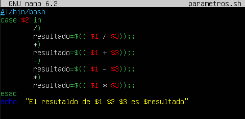
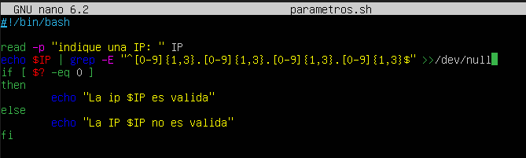
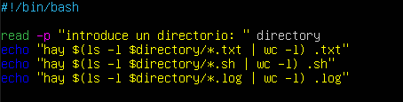
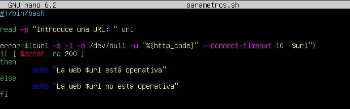
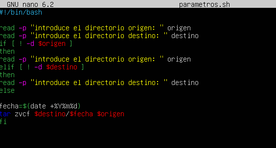

# PRACTICA 3 DE LA UT3 JULIÁN ALMARZA ÁLVAREZ

1. Calculadora básica
Crea un script que funcione como una calculadora de operaciones básicas.

Debe recibir como parámetros:

Primer número
Operación (+, -, *, /)
Segundo número Si no se pasan parámetros, debe solicitar los valores al usuario.
Debe manejar errores, como división por 0.





2. Validador de direcciones IP
Crea un script que verifique si una dirección IP es válida.

Debe recibir la dirección IP como parámetro.
Si no se pasa, debe pedirla al usuario.
Usa grep para validar el formato X.X.X.X, donde X es un número que tiene entre 1 y 3 dígitos.





3. Crea un script que cuente archivos de distintos tipos en un directorio.

Debe recibir el directorio como parámetro (si no se pasara el parámetro lo solicitará por teclado).
Mostrará cuántos archivos hay de cada extensión (```.txt,``` ```.sh,``` ```.log```, etc.).
Usa ```find``` y ```grep``` para procesar los datos.





4. Crea un script que verifique si una página web está accesible.

Debe recibir una URL como parámetro
Debe hacer un curl para comprobar si responde con código 200.
Si está caída, debe mostrar una alerta.





5. Crea un script que realice una copia de seguridad de un directorio.

Debe recibir el directorio origen y el directorio destino como parámetros.
Si no se pasan, debe solicitarlos.
Usa el comando tar para generar el backup con la fecha actual en el nombre.





6. Crea un script que convierta una temperatura entre Celsius y Fahrenheit.

Debe recibir la temperatura y la unidad como parámetros (C o F).
Si no se pasan, debe solicitarlos al usuario.


7. Crea un script que genere un nombre aleatorio para un archivo.

Debe aceptar una extensión como parámetro.
Si no se pasa, debe preguntar al usuario.
Usa /dev/urandom o date para generar nombres únicos.


8. Crea un script que compare dos archivos y muestre las diferencias.

Debe recibir los dos archivos como parámetros.
Si no se pasan, debe solicitarlos.
Usa diff para comparar y mostrar diferencias resaltadas.


9. Crea un script que genere un número aleatorio entre un mínimo y un máximo.

Debe recibir los valores mínimo y máximo como parámetros.
Si no se pasan, debe solicitarlos al usuario.
Usa $RANDOM para generar el número.


