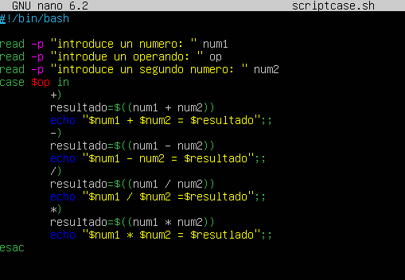
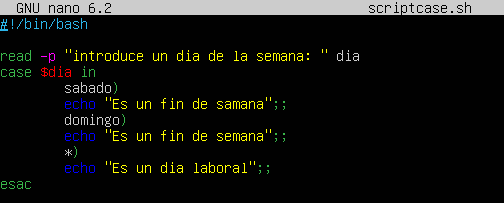
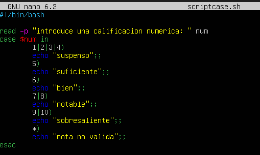

# PRACTICA 2 DE LA UT3 JULIÁN ALMARZA ÁLVAREZ

1. Crea un script que muestre un menú con opciones para sumar, restar, multiplicar y dividir dos números. Debe pedir primero un operando, luego el otro y finalmente la operación a realizar. Usa case para realizar la operación seleccionada por el usuario.

2. Haz un script que lea un día de la semana como entrada y responda si es un día laboral o de fin de semana.

3. Crea un script que reciba una calificación numérica del 0 al 10 e indique la nota correspondiente: sobresaliente (9 o 10), notable (7 u 8), bien (6), suficiente (5) o suspenso (0 a 4).

4. El usuario ingresa un mes del año, y el script responde con la estación correspondiente (primavera, verano, otoño o invierno).

Opcionalmente puedes intentar mejorar el script preguntando también el día del mes para responder con más precisión.