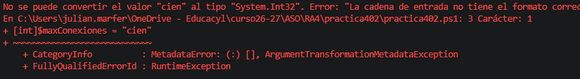

1. - Comprobando el tipado dinámico

Declara una variable llamada $recurso y asígnale el valor numérico 8080. Muestra por pantalla el nombre de su tipo de dato. A continuación, en la línea siguiente, asígnale la cadena "Puerto HTTP" a esa misma variable y vuelve a mostrar su tipo de dato.

```
$recurso = 888
$recurso.GetType().name
$recurso = "Puerto HTTP"
$recurso.GetType().name
```
2. - Forzando el tipado estático

Declara con tipado estático una variable entera llamada $maxConexiones con valor 100 y una variable booleana llamada $firewallActivo con valor $true. Escribe en un comentario qué error exacto devuelve PowerShell si intentas ejecutar $maxConexiones = "Cien".





3. - Números grandes y precisión financiera
   Declara una variable $tamanoBackup que almacene el valor de 2 Terabytes expresado en bytes (2199023255552) forzando el tipo Int64 mediante su sufijo correspondiente (L) o mediante cast [long].
   Declara dos variables de alta precisión ([decimal] o sufijo d): $costeLicencia = 149.95d y $iva = 31.49d. Calcula la suma de ambas en $totalFactura y muéstrala por pantalla.

```
   [long]$tamanoBackup = 2199023255552
    $costeLicencia = 149.95d
    $iva = 31.49d
    $totalFactura = $costeLicencia + $iva
    Write-Host $totalFactura
```
4. - Cálculo de tiempos de ejecución (DateTime y TimeSpan)
   Guarda la fecha y hora actual en $fechaActual. Muestra por pantalla un mensaje que indique el año actual (.Year) y la fecha exacta en la que caducará una contraseña si vence dentro de 45 días (.AddDays()).

Simula una tarea midiendo su duración: captura la fecha en $inicio, ejecuta una pausa de 3 segundos con Start-Sleep -Seconds 3, captura la fecha en $fin y almacena la resta de ambas en una variable de tipo [TimeSpan]$tiempoTotal. Muestra por pantalla los segundos totales transcurridos (.TotalSeconds).
``` 
    $fechaActual = Get-Date
    Write-Host $fechaActual.Year
    Write-Host "La contrasenia caducara exactamente el" $fechaActual.AddDays(45)
```
